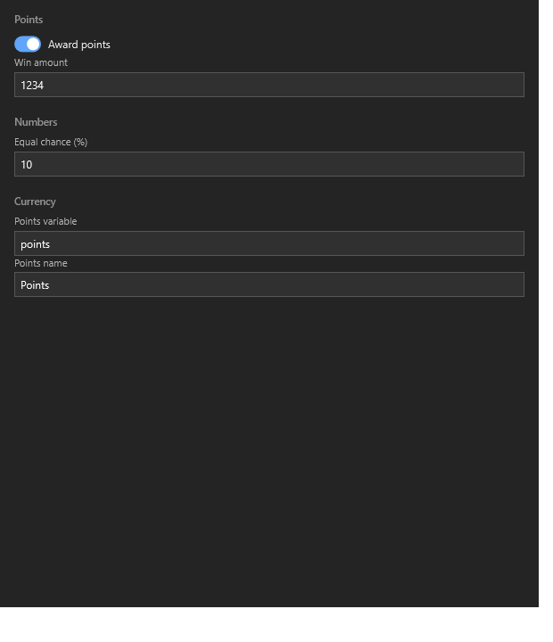
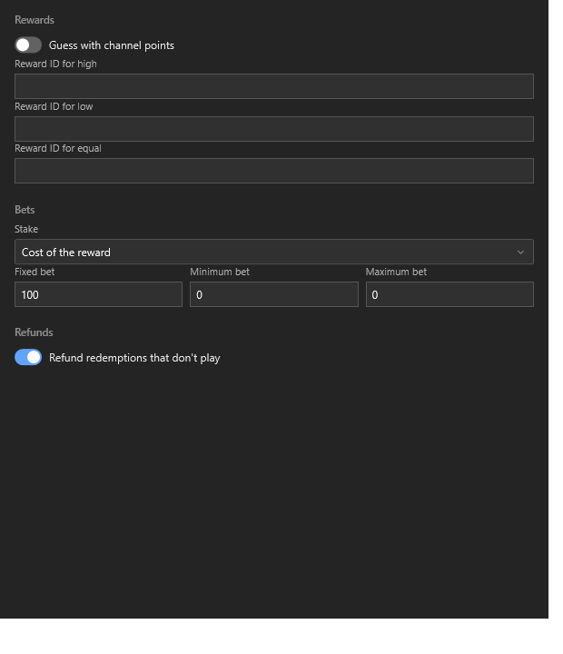
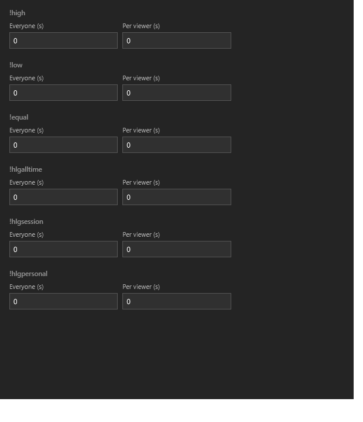
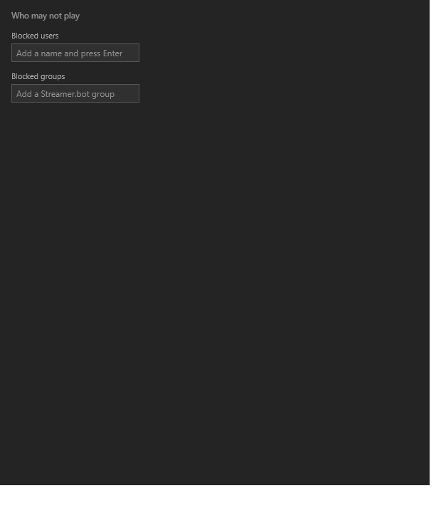
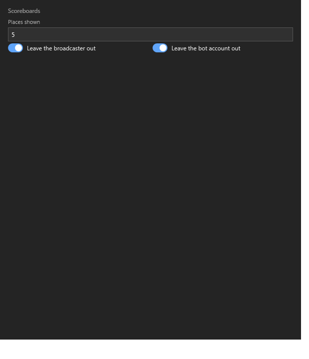
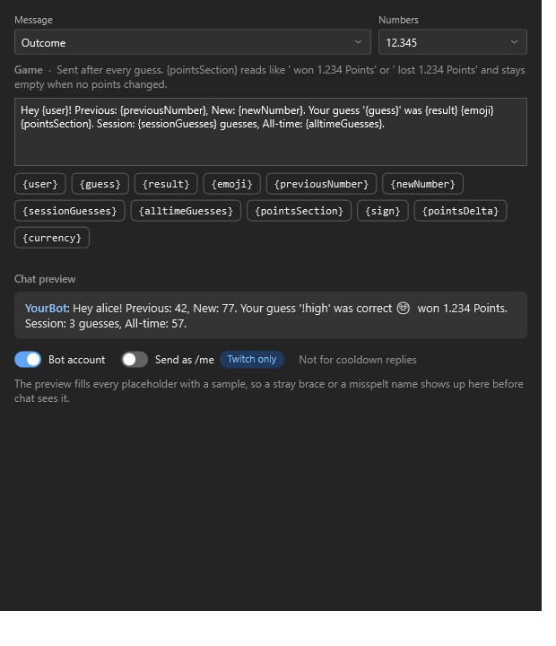
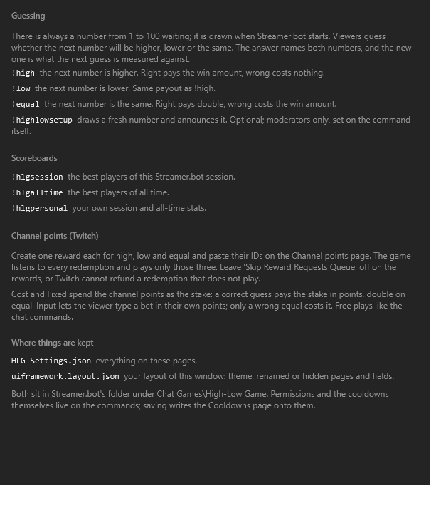
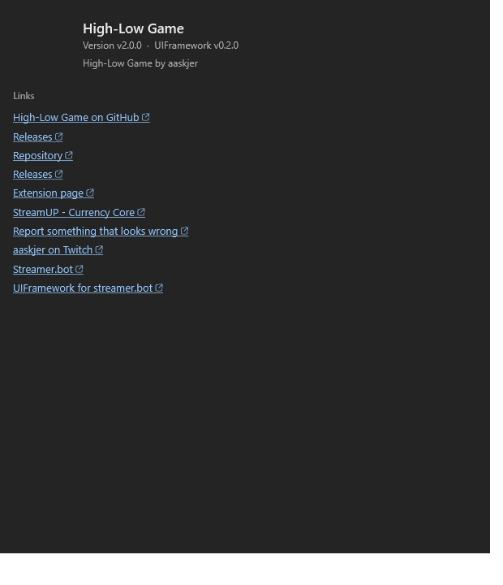

# Import

1. Copy the whole string from [Import-String.md](Import-String.md), or take `HighLowGame.sb` from the
   [latest release](https://github.com/aaskjer/High-Low-Game/releases).
2. In Streamer.bot click **Import**, paste the string (or drop the file) and import everything.

You get three actions in the group `[HLG] High-Low Game`:

| Action | What it does |
| --- | --- |
| `[HLG] - High-Low Game` | The game: `!high`, `!low`, `!equal`, `!highlowsetup` and the channel point rewards |
| `[HLG] - Scoreboard` | `!hlgsession`, `!hlgalltime`, `!hlgpersonal` |
| `[HLG] - .Settings` | Opens the settings window from its Test trigger |

Coming from 1.x: import over the old actions. `HLG-Settings.json` stays where it is and is read as before.

## Enable Commands

Commands arrive disabled. Open **Commands**, group `[HLG] High-Low Game`, and enable the seven you play with.
While you are there:

- `!highlowsetup` is limited to the **Moderators** group. It is optional; the game runs without it.
- `!SetFreeHighLow` and `!EndFreeHighLow` (Moderators too) switch Free mode from chat. Optional as well; enable
  them if you want them.
- Every command listens on Twitch, YouTube and Kick. To leave a platform out, untick its source on the commands.

# Setup

Open `[HLG] - .Settings`, right-click its **Test** trigger and choose **Test Trigger**.

The first time, a dialog asks whether to download `UIFramework.dll` from GitHub (checked against its published
SHA-256) or to show the folder it belongs in, `UIFramework\lib\<version>\` next to Streamer.bot. Nothing is
downloaded without your click. When a newer UIFramework comes out, opening the window offers it once.

Everything is saved to `Chat Games\High-Low Game\HLG-Settings.json` in the Streamer.bot folder.

## Game

- **Award points**: off, and nobody wins or loses points. Guesses still count for the scoreboards.
- **Free mode**: the same, but meant to be switched for a while: `!SetFreeHighLow` and `!EndFreeHighLow` turn it
  on and off from chat, with the Started and Ended messages, and the window's pill shows it.
- **Win amount**: paid for a correct `!high` or `!low`. A correct `!equal` pays double, a wrong `!equal` costs the
  win amount. A wrong `!high` or `!low` costs nothing.
- **Equal chance**: how often an `!equal` guess draws the same number again. Every other draw is a free pick from
  1 to 100.
- **Points variable** and **Points name**: where points are kept and what they are called in chat. With
  [Currency Core](https://streamup.tips/product/currency-core) installed, its own settings are used instead.

## Channel points

Twitch only. YouTube and Kick always play with the chat commands.

1. On Twitch, create one custom reward each for high, low and equal. Leave **Skip Reward Requests Queue** off,
   or Twitch cannot refund a redemption that does not play.
2. Paste the three reward IDs here and turn on **Guess with channel points**. From then on `!high`, `!low` and
   `!equal` do nothing in Twitch chat.
3. Pick the **Stake**:

| Stake | What is bet | Correct guess | Wrong guess |
| --- | --- | --- | --- |
| Cost of the reward | the channel points spent | the reward's cost in points, double on equal | nothing more |
| Fixed bet | the channel points spent | the **Fixed bet** in points, double on equal | nothing more |
| Viewer types a bet | the viewer's own points, typed into the redemption | the bet, double on equal | `!equal` costs the bet, `!high`/`!low` nothing |
| Free, like chat | the channel points spent | the win amount, double on equal | `!equal` costs the win amount |

For a typed bet the reward needs **Require Viewer to Enter Text**. Viewers can type a number, `all`, `half`,
`third`, `quarter`, `random`, a percentage like `25%` or a short form like `2k`. A bet they cannot afford is
refused. **Minimum bet** and **Maximum bet** apply to typed and fixed bets; 0 turns them off.

**Refund redemptions that don't play** gives the channel points back whenever a redemption ends without a
guess: blocked viewer, cooldown, refused bet or an error. Played redemptions are marked as fulfilled.

## Cooldowns

One global and one per-viewer cooldown for every command, in seconds. Saving writes them onto the commands.
The three guess cooldowns also cover the matching rewards; a redemption that comes in during one is refunded.

## Access

**Blocked users** and everyone in the **Blocked groups** (Streamer.bot's Settings > Groups) are ignored, with no
reply in chat. Their redemptions are refunded.

## Scoreboard

How many places `!hlgsession` and `!hlgalltime` list, and whether the broadcaster and the bot account are left
out. They still play; they are just not ranked.

## Messages

Every chat message with its placeholders and a live preview, plus the sender switches: bot account or
broadcaster, and `/me` on Twitch. An empty message is not sent.

## How to play

## About

